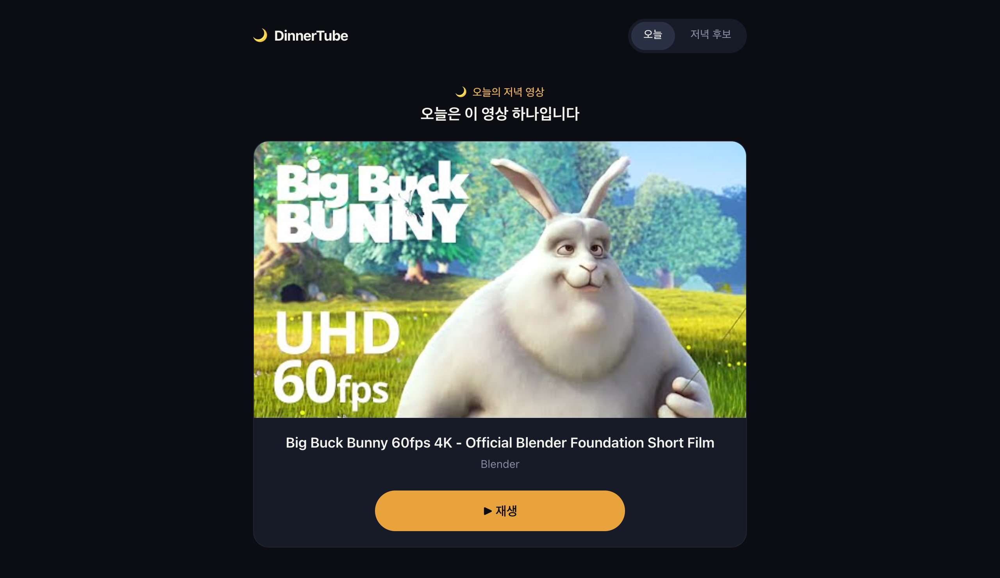
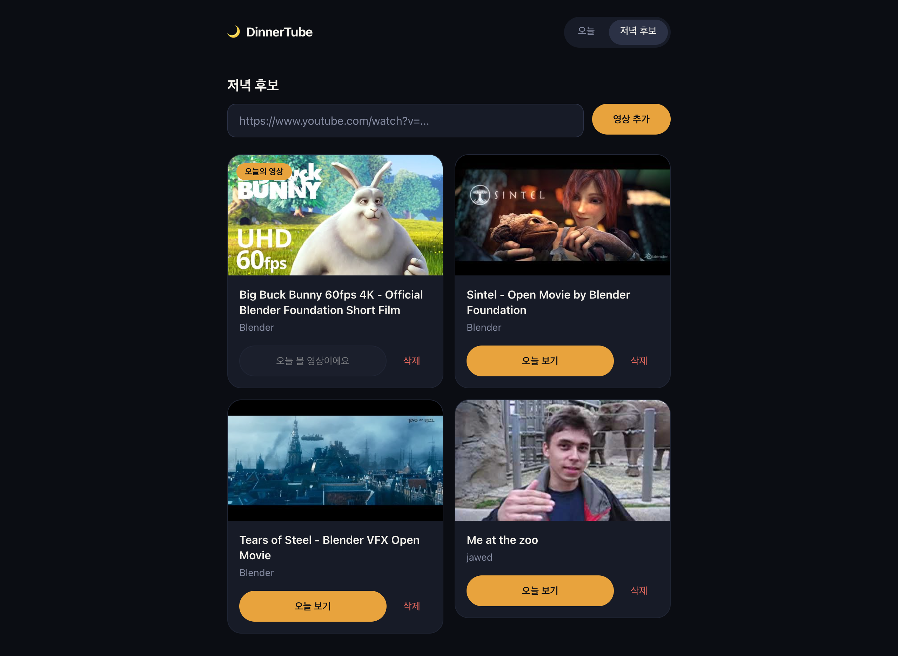
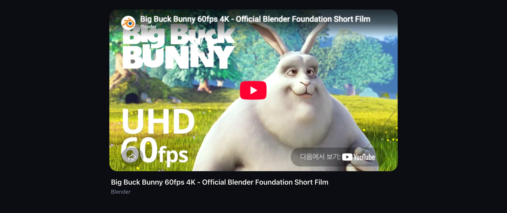
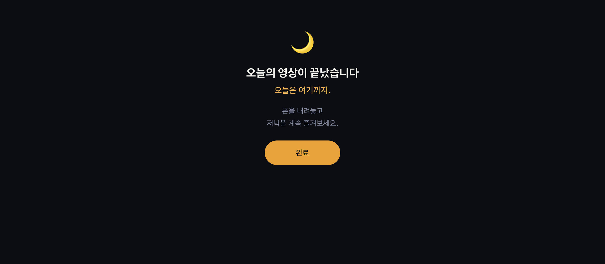
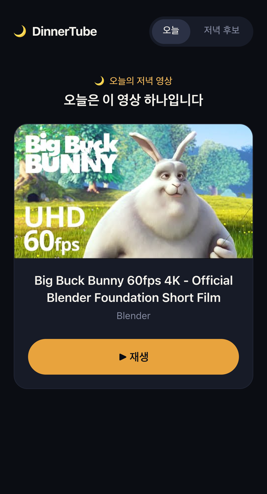

<div align="center">

# 🌙 DinnerTube

### 오늘은 하나만. 영상이 끝나면, 저녁으로 돌아갑니다.

**밥 먹으면서 영상 하나 틀었다가 정신 차려보니 두 시간.**
DinnerTube는 그 "딱 하나만 더"를 끊어주는 개인용 YouTube 영상 큐입니다.


[](LICENSE)

### 👉 [지금 바로 써보기 — dinnertube.vercel.app](https://dinnertube.vercel.app/)



</div>

---

## 🍚 이런 적 있지 않나요?

- 저녁 먹으면서 볼 영상 하나 고르다가 **밥이 다 식었다**
- 영상 하나만 보려고 했는데 **추천 영상에 끌려 다녔다**
- 끝나자마자 자동 재생된 다음 영상을 **멍하니 계속 봤다**

YouTube가 나쁜 건 아닙니다. 다만 **끝이 없게 설계되어 있을 뿐**이죠.

## 💡 DinnerTube의 해법: "끝"을 되돌려 드립니다

> 고르는 건 **미리**, 보는 건 **하나만**, 끝나면 **진짜 끝.**

| 일반 YouTube | DinnerTube |
| --- | --- |
| 무한 추천 피드 | 내가 미리 골라둔 후보만 |
| 끝나면 다음 영상 자동 재생 | 끝나면 **종료 화면** |
| 검색·Shorts·알림으로 이탈 | 탐색 요소 **0개** |
| 오늘 몇 개 봤는지 모름 | 오늘의 영상은 **딱 하나** |

## ✨ 주요 기능

### 📥 저녁 후보 담아두기
YouTube URL을 붙여넣으면 제목·썸네일·채널을 자동으로 불러와 후보 목록에 저장합니다.
잘못된 URL, 비공개·삭제된 영상, 이미 담은 영상은 친절하게 알려드려요.

### 🎯 오늘의 영상 하나
후보 중 하나를 "오늘의 영상"으로 골라두면, 앱을 열자마자 **그 영상 하나만** 보입니다.
날짜가 바뀌면 선택은 자동으로 초기화돼요.

### 🎬 재생, 그리고 끝
공식 YouTube 플레이어로 재생하고, 영상이 끝나면 추천 대신 **종료 화면**으로 전환됩니다.
오늘 이미 다 봤다면 다시 들어와도 플레이어가 아닌 종료 화면이 반겨줍니다.

### 🔒 가볍고 사적인
- **로그인 없음, 서버 없음** — 모든 데이터는 내 브라우저(LocalStorage)에만 저장
- **API 키 불필요** — YouTube oEmbed + IFrame Player만 사용
- 저장 데이터가 손상돼도 앱이 깨지지 않고 안전하게 복구

## 📸 스크린샷

| 📥 저녁 후보 | 🎬 재생 |
| :---: | :---: |
|  |  |
| **🌙 끝 — 다음 영상은 없습니다** | **📱 모바일** |
|  |  |

<sub>예시 영상: Blender Foundation 오픈 무비(Big Buck Bunny, Sintel, Tears of Steel) 외</sub>

## 🔄 하루의 흐름

```
 낮에 미리             저녁 식사 시간           식사 끝
┌──────────┐        ┌──────────────┐       ┌──────────────┐
│ /queue   │  고르기 │ /  오늘의 영상 │  재생  │ /watch       │
│ 후보 담기 │ ─────▶ │ 딱 하나만 노출 │ ─────▶ │ 끝 → 종료 화면 │
└──────────┘        └──────────────┘       └──────────────┘
                                                  │
                                    다음 영상 없음 · 추천 없음 · 오늘은 여기까지 🌙
```

## 🚀 지금 바로 써보기

설치도, 가입도 필요 없습니다.
👉 **[dinnertube.vercel.app](https://dinnertube.vercel.app/)** 을 열고 첫 번째 저녁 영상을 담아보세요.

### 직접 실행해보고 싶다면

```bash
git clone https://github.com/nwewave32/dinner-menu.git
cd dinner-menu
npm install
npm run dev
```

```bash
npm test           # 테스트 실행 (Vitest)
npm run typecheck  # 타입 검사
npm run build      # 프로덕션 빌드
```

## 🛠 기술 스택

| 영역 | 사용 기술 |
| --- | --- |
| 프레임워크 | **Next.js** (App Router) + **TypeScript** |
| 스타일 | **Tailwind CSS** |
| YouTube 연동 | **IFrame Player API** + **oEmbed** (API 키 불필요) |
| 저장소 | **LocalStorage** + **zod** 스키마 검증 |
| 테스트 | **Vitest** + Testing Library |

## 📁 프로젝트 구조

```
app/          # 화면 — /(오늘의 영상), /watch(재생·종료), /queue(저녁 후보)
components/   # ui(디자인 시스템) / video / player / layout
lib/          # YouTube 연동, LocalStorage repository
hooks/        # useQueue, useToday
tests/        # unit · integration 테스트
```

## 🧪 믿을 수 있는 동작

URL 파싱, oEmbed 오류 처리, 저장소 복구, 영상 추가 폼, 재생 → 종료 전환까지
핵심 흐름을 unit · integration 테스트로 검증합니다.

## 🤝 기여하기

"저녁에 영상 하나만" 보고 싶은 분이라면 누구나 환영합니다.
이슈와 PR로 아이디어를 나눠주세요.

## 📄 License

[MIT License](LICENSE) © 2026 nwewave32
누구나 자유롭게 사용·수정·배포할 수 있습니다. 자세한 내용은 [LICENSE](LICENSE) 파일을 참고하세요.

---

<div align="center">

**오늘은 여기까지. 맛있는 저녁 되세요 🍽️**

</div>
